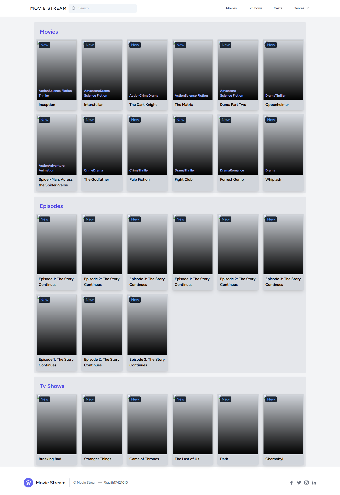
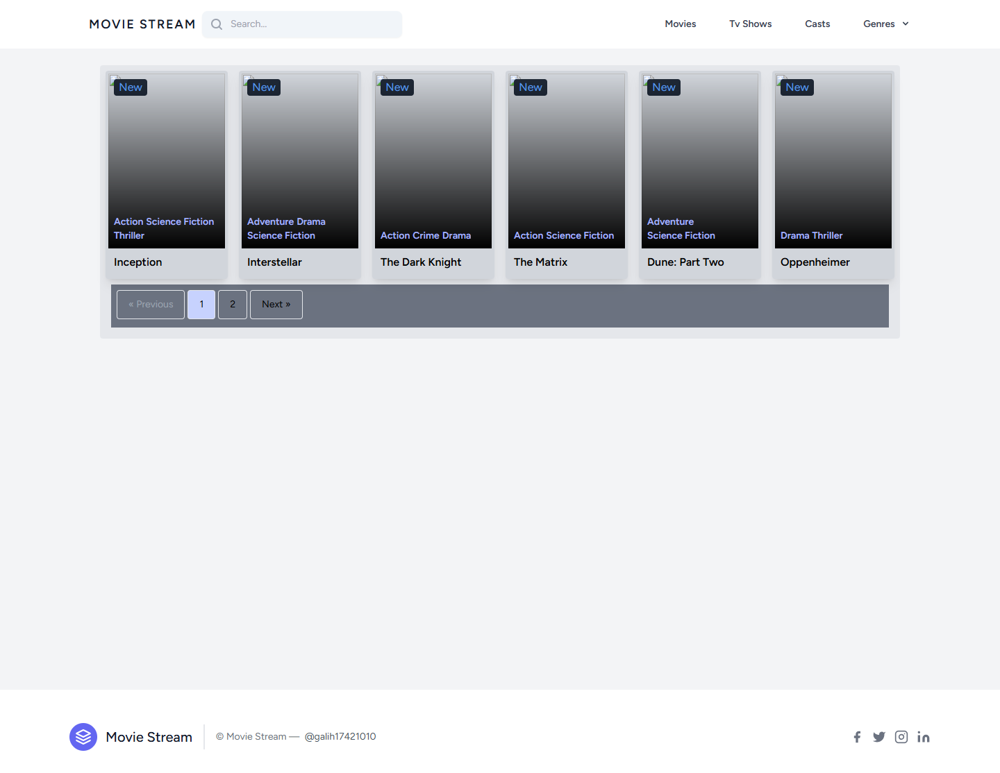
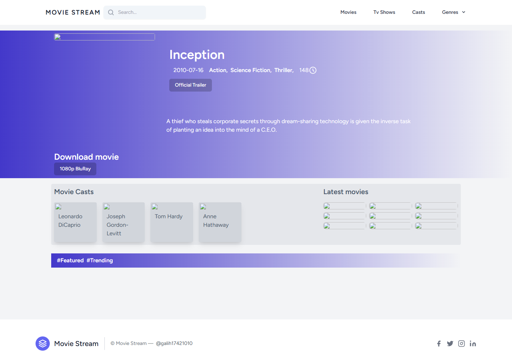
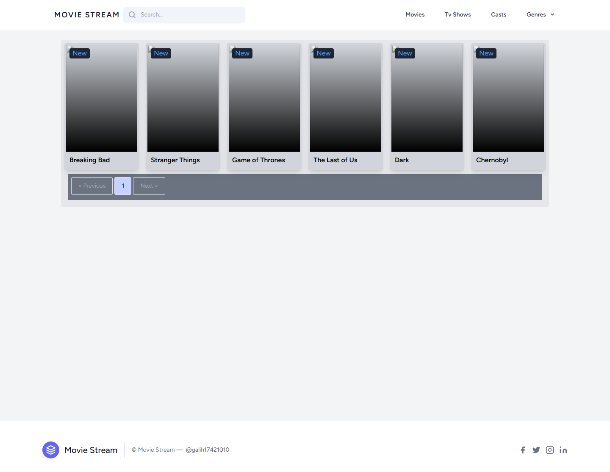
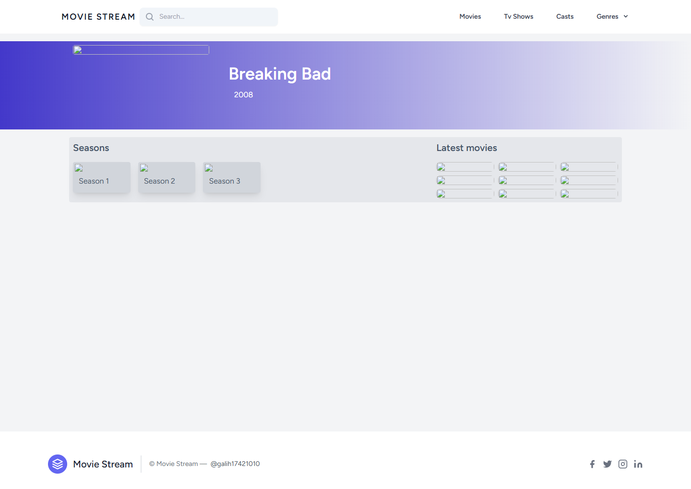
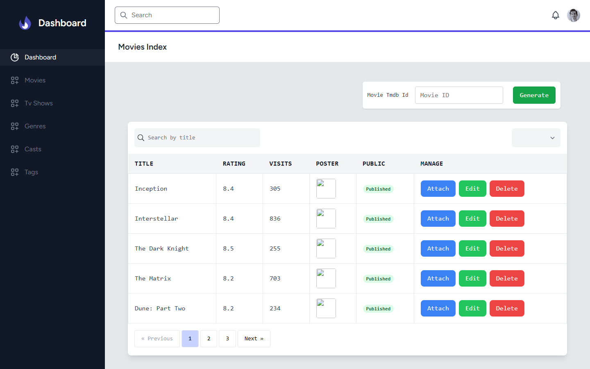
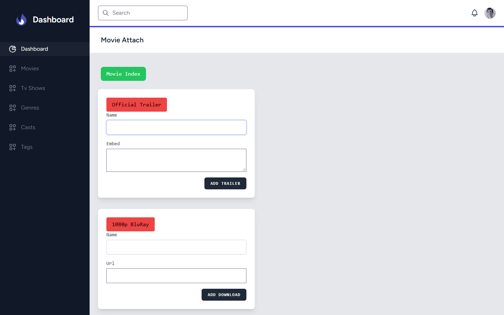

# MovieStream

MovieStream adalah aplikasi katalog film dan serial TV berbasis web. Aplikasi ini menyediakan halaman publik untuk menjelajahi konten, serta panel admin untuk mengimpor metadata dari TMDB dan mengelola trailer, tautan unduhan, pemeran, genre, dan tag.

Dibangun dengan **Laravel 10**, **Inertia.js**, **Vue 3**, **Tailwind CSS**, dan **MySQL 8**.

## Daftar Isi

- [Fitur Utama](#fitur-utama)
- [Tangkapan Layar](#tangkapan-layar)
- [Stack Teknologi](#stack-teknologi)
- [Menjalankan Aplikasi](#menjalankan-aplikasi)
- [Konfigurasi Environment](#konfigurasi-environment)
- [Pengujian](#pengujian)
- [Struktur Proyek](#struktur-proyek)
- [Keamanan](#keamanan)
- [Atribusi](#atribusi)

## Fitur Utama

- Katalog film dan serial TV dengan pencarian, pagination, dan pengurutan.
- Halaman detail film, serial TV, musim, episode, pemeran, genre, dan tag.
- Panel admin dengan autentikasi dan otorisasi role `admin`.
- Impor metadata film, serial TV, musim, episode, pemeran, dan genre dari TMDB.
- Pengelolaan trailer, tautan unduhan, pemeran, genre, dan tag per film.
- Validasi server-side untuk seluruh input admin.
- Penghapusan berantai untuk data terkait (season, episode, lampiran, dan pivot).
- Antarmuka responsif menggunakan Tailwind CSS.
- Lingkungan pengembangan Docker untuk aplikasi, Vite, dan MySQL.

## Tangkapan Layar

> Tangkapan layar menggunakan data demo. Tampilan aktual bergantung pada isi database.

### Halaman Publik

| **Beranda** | **Katalog Film** |
| :---: | :---: |
| [](docs/screenshots/home.png) | [](docs/screenshots/movies.png) |
| **Detail Film** | **Katalog Serial TV** |
| [](docs/screenshots/movie-detail.png) | [](docs/screenshots/tv-shows.png) |
| **Detail Serial TV** | |
| [](docs/screenshots/tv-show-detail.png) | |

### Panel Admin

| **Daftar Film** | **Pengelolaan Lampiran Film** |
| :---: | :---: |
| [](docs/screenshots/admin-movies.png) | [](docs/screenshots/admin-attach.png) |

## Stack Teknologi

| Komponen | Teknologi |
| --- | --- |
| Backend | PHP 8.2, Laravel 10 |
| Frontend | Vue 3, Inertia.js, Tailwind CSS |
| Build Tool | Vite 4 |
| Database | MySQL 8 |
| Autentikasi & Otorisasi | Laravel Jetstream, Sanctum, Spatie Permission |
| Pencarian | Spatie Searchable |
| Sumber Metadata | TMDB API |
| Pengembangan | Docker, Docker Compose |

## Menjalankan Aplikasi

### Opsi 1: Docker (disarankan)

#### Prasyarat

- [Docker](https://docs.docker.com/get-docker/) dan Docker Compose.
- Koneksi internet untuk instalasi dependency dan pengambilan gambar dari TMDB.
- API Key TMDB apabila ingin menggunakan fitur impor konten.

#### Langkah Menjalankan

1. Clone repositori dan masuk ke direktori proyek.

   ```bash
   git clone https://github.com/galihagussaputra/MovieStream.git
   cd MovieStream
   ```

2. Siapkan file environment.

   ```bash
   cp .env.example .env
   ```

3. Isi API Key TMDB pada `.env` (opsional, tetapi diperlukan untuk impor konten).

   ```dotenv
   TMDB_SECRET=api_key_tmdb_anda
   TMDB_ENDPOINT=https://api.themoviedb.org/3/
   ```

   API Key dapat dibuat melalui [pengaturan API TMDB](https://www.themoviedb.org/settings/api).

4. Jalankan seluruh service.

   ```bash
   docker compose up -d --build
   ```

   Service yang dijalankan:

   - `app`: Laravel di `http://localhost:8000`
   - `vite`: Vite dev server di `http://localhost:5173`
   - `db`: MySQL (port host mengikuti variabel `DB_PORT`)

5. Jalankan migrasi database.

   ```bash
   docker compose exec app php artisan migrate
   ```

6. Buat akun admin pertama.

   ```bash
   docker compose exec app php artisan tinker --execute="\$user = App\Models\User::factory()->create(['name' => 'Admin', 'email' => 'admin@example.com', 'password' => bcrypt('password')]); \$user->assignRole(Spatie\Permission\Models\Role::findOrCreate('admin'));"
   ```

   Setelah login, segera ganti password melalui halaman profil.

7. Buka aplikasi.

   - Aplikasi: `http://localhost:8000`
   - Panel admin: `http://localhost:8000/admin`
   - Login: `http://localhost:8000/login`

#### Perintah Docker yang Sering Digunakan

| Perintah | Fungsi |
| --- | --- |
| `docker compose ps` | Melihat status service |
| `docker compose logs -f app` | Melihat log aplikasi |
| `docker compose exec app php artisan migrate` | Menjalankan migrasi |
| `docker compose exec app php artisan db:seed` | Menjalankan seeder |
| `docker compose down` | Menghentikan semua service |
| `docker compose down -v` | Menghentikan service dan menghapus volume database |

> **Catatan:** `docker compose down -v` akan menghapus data MySQL yang tersimpan di volume Docker.

### Opsi 2: Menjalankan Tanpa Docker

#### Prasyarat

- PHP 8.1 atau lebih baru beserta ekstensi `bcmath`, `gd`, `pdo_mysql`, dan `zip`.
- Composer 2.
- MySQL 8.
- Node.js 18 atau lebih baru dan npm.

#### Langkah Menjalankan

1. Install dependency backend.

   ```bash
   composer install
   ```

2. Siapkan file environment dan application key.

   ```bash
   cp .env.example .env
   php artisan key:generate
   ```

3. Sesuaikan koneksi database dan API Key TMDB pada `.env`.

   ```dotenv
   DB_CONNECTION=mysql
   DB_HOST=127.0.0.1
   DB_PORT=3306
   DB_DATABASE=stream_app
   DB_USERNAME=root
   DB_PASSWORD=

   TMDB_SECRET=api_key_tmdb_anda
   TMDB_ENDPOINT=https://api.themoviedb.org/3/
   ```

4. Buat database `stream_app`, lalu jalankan migrasi.

   ```bash
   php artisan migrate
   ```

5. Install dependency frontend dan jalankan Vite.

   ```bash
   npm install
   npm run dev
   ```

6. Jalankan server Laravel pada terminal terpisah.

   ```bash
   php artisan serve
   ```

7. Buka `http://localhost:8000`.

## Konfigurasi Environment

Variabel penting yang perlu diperhatikan:

| Variabel | Wajib | Deskripsi |
| --- | --- | --- |
| `APP_KEY` | Ya | Application key Laravel. Dibuat otomatis oleh entrypoint Docker jika belum ada. |
| `APP_URL` | Ya | URL dasar aplikasi, misalnya `http://localhost:8000`. |
| `DB_CONNECTION` | Ya | Driver database, gunakan `mysql`. |
| `DB_HOST` | Ya | Host database. Pada Docker gunakan `db`. |
| `DB_PORT` | Ya | Port database. Pada Docker gunakan `3306` dari dalam container. |
| `DB_DATABASE` | Ya | Nama database, default `stream_app`. |
| `DB_USERNAME` | Ya | Username database. |
| `DB_PASSWORD` | Ya | Password database. |
| `TMDB_SECRET` | Untuk impor | API Key TMDB v3. |
| `TMDB_ENDPOINT` | Tidak | Endpoint TMDB, default `https://api.themoviedb.org/3/`. |

File `.env` tidak boleh di-commit. Gunakan `.env.example` sebagai referensi konfigurasi.

## Pengujian

Test menggunakan `RefreshDatabase`, sehingga sebaiknya dijalankan pada database khusus test agar data pengembangan tidak terhapus.

```bash
docker compose up -d db
docker compose exec db mysql -uroot -proot -e "CREATE DATABASE IF NOT EXISTS stream_app_test; GRANT ALL PRIVILEGES ON stream_app_test.* TO 'stream'@'%'; FLUSH PRIVILEGES;"
docker compose run --rm --no-deps -e DB_DATABASE=stream_app_test app php artisan test
```

Untuk menjalankan test tertentu:

```bash
docker compose run --rm --no-deps -e DB_DATABASE=stream_app_test app php artisan test --filter=AdminValidationTest
```

Test mencakup validasi input admin, penghapusan data terkait, pencarian serial TV, dan pembatasan nested route admin.

## Struktur Proyek

```text
app/
  Http/Controllers/Admin/       # Controller panel admin
  Http/Controllers/Frontend/    # Controller halaman publik
  Models/                       # Model Eloquent
database/
  migrations/                   # Skema database
  seeders/                      # Seeder data
docs/
  screenshots/                  # Gambar dokumentasi
resources/
  js/Pages/                     # Halaman Inertia + Vue
  js/Layouts/                   # Layout publik dan admin
routes/
  web.php                       # Route publik dan admin
tests/
  Feature/                      # Feature test
docker/
  php/entrypoint.sh             # Entrypoint container aplikasi
docker-compose.yml              # Konfigurasi service Docker
```

## Keamanan

- Jangan pernah meng-commit file `.env` atau API Key TMDB.
- Gunakan API Key khusus untuk pengembangan dan rotasi key jika pernah terekspos.
- Panel admin dilindungi oleh middleware `auth`, `verified`, dan role `admin`.
- Input admin divalidasi di sisi server sebelum disimpan.
- Gunakan HTTPS dan konfigurasi database yang kuat saat deployment produksi.

## Atribusi

- Metadata dan gambar film/serial TV berasal dari [TMDB](https://www.themoviedb.org/). Aplikasi ini tidak disponsori atau disertifikasi oleh TMDB.
- Framework dan library utama: [Laravel](https://laravel.com/), [Inertia.js](https://inertiajs.com/), [Vue.js](https://vuejs.org/), dan [Tailwind CSS](https://tailwindcss.com/).
